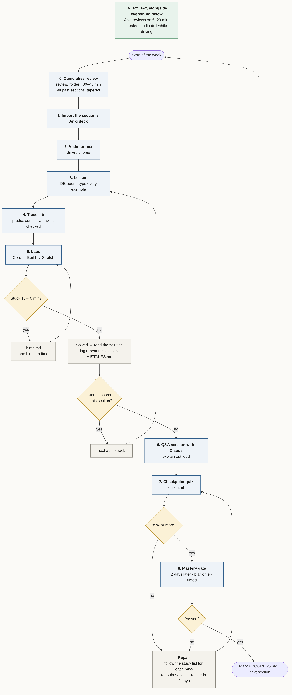

# AI-Augmented Python DSA Learning Plan

A self-paced course for passing software engineering coding interviews in Python.
It starts at the beginning. It ends at dynamic programming.
It is built to be learned, not skimmed.

The spine is the **LeetCode Top Interview 150**, cross-referenced with **NeetCode 150**
and **Codility Lessons**. Every section is taught five ways: audio, reading, coding labs,
flashcards, and quizzes. You move on when you can prove mastery, not when the calendar says so.

> Built by Daniel McKinlay ([@Akraetik](https://github.com/Akraetik)) with Claude.
> Repo: [Akraetik/ai-augmented-python-dsa-learning-plan](https://github.com/Akraetik/ai-augmented-python-dsa-learning-plan)
> The original prompt that generated this course is in [PROMPT.md](PROMPT.md). Fork it. Use it for your own topic.

---

## Who this is for

- You know a little Python, or none.
- You want to pass the coding portion of an SWE interview or online assessment (LeetCode, Codility, HackerRank, CoderPad).
- You learn in pieces: some time at a desk, some time driving, some short breaks.

## How to study: the flow



Short version: **cumulative review → audio → lesson → trace lab → labs → (repeat per lesson) → Q&A → quiz → gate.**
Anki and the audio drill run every day alongside all of it. Pace: about one section per week
(Section 01 is the exception; it has 24 problems, so plan on two to three weeks).
The chart's source is `docs/study-flow.mmd`. Setting up the GitHub repo: [docs/GITHUB-SETUP.md](docs/GITHUB-SETUP.md).

Full reasoning for every step is in [METHOD.md](METHOD.md). Improvements found while testing are logged in [ITERATIONS.md](ITERATIONS.md).

## Start here

1. Install Python 3.10 or newer and an IDE (VS Code or PyCharm).
2. Install [Anki](https://apps.ankiweb.net/) on desktop and phone (AnkiDroid is free; AnkiMobile is paid).
3. Read [METHOD.md](METHOD.md). Fifteen minutes. It explains why the course is built this way.
4. Open [sections/00-foundations/README.md](sections/00-foundations/README.md) and take the **diagnostic quiz** first.
   Score 85% or better and you can fast-track Section 0.
5. Track progress in [PROGRESS.md](PROGRESS.md). Log every repeated mistake in [MISTAKES.md](MISTAKES.md).
6. Starting with Section 01, open each new section with the [cumulative review](review/README.md). It covers every past section, tapered by age.

## Running a lab

Every lab is a single `.py` file. Open it. Read the problem. Write your plan in the `PLAN` comment.
Write your code. Run the file.

```
python sections/01-array-string/labs/lab_01_merge_sorted_array.py
```

You'll see each test pass or fail, with the input, the expected answer, and what your code returned.
Large-input tests also check speed, like Codility's hidden performance tests.
When a test fails, the lab prints a **STUDY** list: the lesson file and section to re-read, the hint to open,
and the mistake log to check. Trace and Big-O labs name the exact lesson section for each wrong answer.

Stuck? Open the section's `hints.md`. Each problem has three hints. Open one at a time.
Full solutions are in the section's `solutions/` folder. Open them only after you've solved it or given it a real fight.

To check every lab in a section at once:

```
python tools/run_labs.py sections/01-array-string
```

## What's in a section

| Folder / file | What it is | When to use it |
|---|---|---|
| `README.md` | The section's step-by-step path and mastery gate | Start of the section |
| `lessons/` | Reading with worked examples and trace exercises | Desk time, IDE open |
| `labs/` | Problems with built-in tests | Desk time |
| `hints.md` | Three-tier hint ladder per problem | When stuck 15+ min |
| `solutions/` | Solutions with complexity, pitfalls, alternatives | After solving |
| `anki/` | `.apkg` deck to import, plus a `.csv` backup | Daily breaks |
| `audio/` | MP3 tracks and their transcripts | Driving, chores |
| `quiz/` | Checkpoint quiz: `quiz.html` (self-scoring, with a study list for every miss) and `quiz.md` | End of section |
| `qa-session.md` | Prompt and question bank for an oral exam with Claude | Before the quiz |

## The sections

| # | Section | Status |
|---|---|---|
| 00 | Foundations: Python for interviews + Big-O | ✅ Built |
| 01 | Array / String | ✅ Built |
| 02 | Two Pointers | ✅ Built |
| 03 | Sliding Window | Planned |
| 04 | Matrix | Planned |
| 05 | Hashmap | Planned |
| 06 | Intervals | Planned |
| 07 | Stack | Planned |
| 08 | Linked List | Planned |
| 09 | Binary Tree General | Planned |
| 10 | Binary Tree BFS | Planned |
| 11 | Binary Search Tree | Planned |
| 12 | Graph General | Planned |
| 13 | Graph BFS | Planned |
| 14 | Trie | Planned |
| 15 | Backtracking | Planned |
| 16 | Divide & Conquer | Planned |
| 17 | Kadane's Algorithm | Planned |
| 18 | Binary Search | Planned |
| 19 | Heap | Planned |
| 20 | Bit Manipulation | Planned |
| 21 | Math | Planned |
| 22 | 1D DP | Planned |
| 23 | Multidimensional DP | Planned |

The full problem map for every section is in [ROADMAP.md](ROADMAP.md).

## Cumulative review

The [review/](review/README.md) folder holds a 30–45 minute review you do at the start of every section:
a review audio track, the [all-triggers table](review/TRIGGERS.md), one-page sheets per section, a mixed quiz,
and timed cold solves. The newest section gets the most weight; older ones taper but never disappear.

## Rebuilding the flashcards and audio

The decks and MP3s are generated from source files in each section. To regenerate them:

```
pip install genanki kokoro-onnx soundfile
python tools/build_anki.py sections/01-array-string
python tools/build_audio.py sections/01-array-string     # needs the Kokoro model files; see tools/README.md
```

## A note on problem statements

LeetCode and Codility own their problem text. Every problem here is described in our own words,
with tests written for this course and a link to the official page. A few well-known example inputs are kept
so you can cross-check. Solve it here, then submit it there.

## License

Course material: [CC BY-NC-SA 4.0](https://creativecommons.org/licenses/by-nc-sa/4.0/). Code: MIT.
