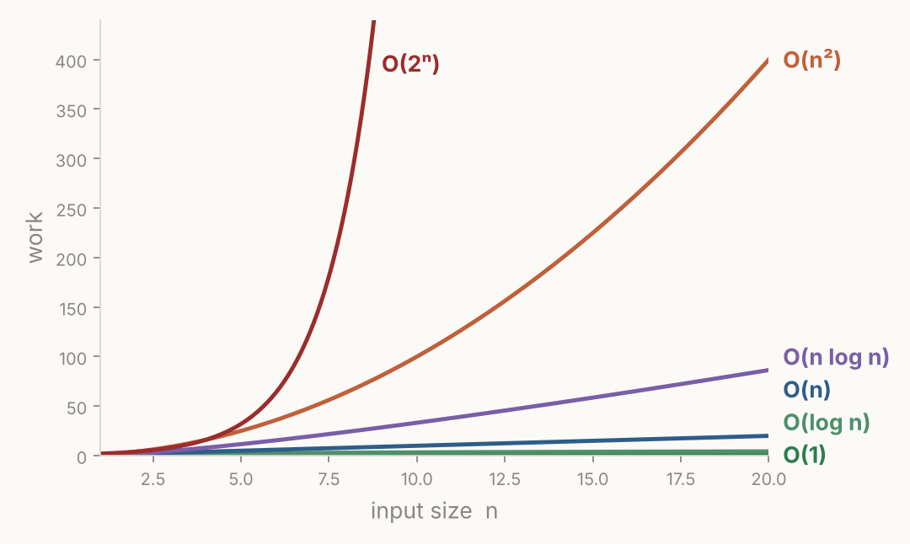

# Review Sheet · 00 Foundations

One page. Read it during each weekly review. If a line looks unfamiliar, open the lesson it names.

## Big-O in one picture

**O(1) → O(log n) → O(n) → O(n log n) → O(n²) → O(2ⁿ)**

| Rule | Example |
|---|---|
| Loops in a row **add** | two loops over n → O(n) |
| Loops inside loops **multiply** | loop in a loop → O(n²) |
| Halving each pass → **log n** | binary search |
| Drop constants and small terms | 3n + 50 → O(n) |
| Sorting | O(n log n) |

## Constraints → target (lesson 00.2)

| Largest n | Target |
|---|---|
| ≤ 20 | 2ⁿ OK (try everything) |
| ≤ 1,000 | n² OK |
| ≤ 10⁵ | n log n or n |
| ≤ 10⁷ | n |
| ≥ 10⁹ | log n or 1 |

## Hidden loops (lesson 00.2)

| Slow, O(n) | Fast, O(1) |
|---|---|
| `x in my_list` | `x in my_set`, `x in my_dict` |
| `nums.pop(0)`, `nums.insert(0, x)` | `nums.pop()`, `nums.append(x)`, `deque.popleft()` |
| `sum` / `max` / `min` / slice inside a loop | a running variable |
| `s += piece` in a loop | `"".join(parts)` once |

## Python you must not hesitate on (lessons 00.3, 00.4)

- **Index vs value:** `for x in nums` gives values. `enumerate` gives both. (M1)
- Slices stop **before** the stop index. `nums[::-1]` reverses.
- `b = a` doesn't copy. `.sort()` returns `None`. `-7 // 2` is `-4`.
- `split()` with no argument drops every extra space.
- `ord(ch) - ord('a')` maps letters to 0–25.
- Grid: `[[0] * C for _ in range(R)]`, never `[[0] * C] * R`.

## Tool triggers (lesson 00.4)

| You need to... | Use |
|---|---|
| ask "seen this before?" | `set` |
| count things | `Counter` / dict with `.get(k, 0) + 1` |
| map value → index | dict |
| group things | `defaultdict(list)` |
| take from the front | `deque` |

## Problems (cold-solve bank)

Contains Duplicate · Running Sum · Max Consecutive Ones · Valid Anagram · **Two Sum** (dict of value → index; check before you store).

## The routine (lesson 00.5)

Restate + RETURNS → example by hand → edge cases → brute force + Big-O → pattern → code → trace.
When stuck: **what work am I repeating?**
