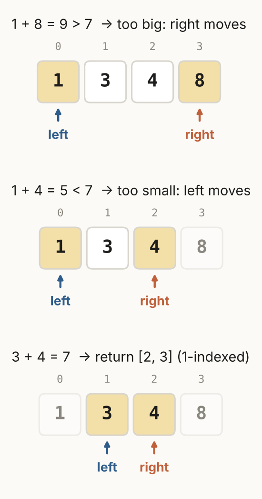

# Review Sheet · 02 Two Pointers

One page. Four shapes. The question that matters: **why is it safe to move that pointer?**

## The shapes

| Lesson | Shape | Trigger | The safe-move reason | Problems |
|---|---|---|---|---|
| 2.1 | Opposite ends | sorted + pair; symmetry | too small: the biggest partner still fails, so drop left | 125, 167, 977 |
| 2.2 | Same direction | "in order" across two sequences | greedy: matching early leaves the most of t | 392 |
| 2.3 | Shrink the weaker side | maximize, capped by the shorter | narrower and no taller can't win | 11 |
| 2.4 | Sort + fix one + two pointers | k numbers summing to X | same as 2.1, on the rest | 15, 16 |
| 2.5 | Pointers replace prefix/suffix lists | same answer, O(1) space | the smaller max is already the water level | 42 |



## Skeletons

```python
left, right = 0, len(a) - 1
while left < right:
    total = a[left] + a[right]
    if total == target: return [left + 1, right + 1]   # 1-indexed for LC 167
    if total < target: left += 1
    else: right -= 1
```

```python
# 3Sum
nums.sort()
for i in range(n - 2):
    if nums[i] > 0: break
    if i > 0 and nums[i] == nums[i - 1]: continue
    left, right = i + 1, n - 1
    # Two Sum II for -nums[i]; after a match, skip repeats on both sides
```

## Traps

- Skip loops in Valid Palindrome need `left < right`.
- Two Sum II returns **1-indexed** positions.
- 3Sum skips with `i - 1`, not `i + 1`.
- New bug from lab 2.09: **moving the wrong pointer.** Too small means move left.
- Two pointers need sorted data (or symmetry). Unsorted pair sums → dict.

## Interleave check

1. "Sorted list. Count pairs below k." → ?
2. "Merge two sorted lists into a new one." → ?
3. "Return k after removing every 0 in place." → ? *(Section 01)*

<details><summary>Answers</summary>2.1 opposite ends (add right − left) · 2.2 same direction · 1.1 read/write</details>
