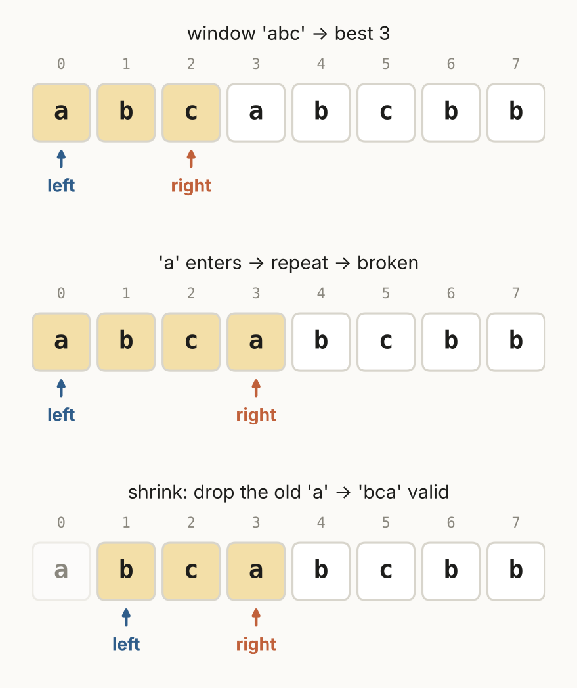

# Review Sheet · 03 Sliding Window

One page. Three templates. Know where you **record** in each.

## The templates

| Lesson | Template | Trigger | Record where | Problems |
|---|---|---|---|---|
| 3.1 | Fixed window | every window of size k | after each slide | 643, 567 |
| 3.2 | Longest valid | longest run that follows a rule | **after** `while broken` | 3, 1004, 424 |
| 3.3 | Shortest valid | shortest run that meets a goal | **inside** `while valid`, before shrinking | 209, 76 |
| 3.4 | Word pieces | all words, same length, any order | when the window holds every word | 30 |



## Skeletons

```python
# longest valid
left = best = 0
for right in range(len(s)):
    add(s[right])
    while broken():
        remove(s[left]); left += 1
    best = max(best, right - left + 1)
```

```python
# shortest valid
left, best = 0, float("inf")
for right in range(len(nums)):
    add(nums[right])
    while valid():
        best = min(best, right - left + 1)
        remove(nums[left]); left += 1
return 0 if best == float("inf") else best
```

## Traps

- Length is `right - left + 1`. (M5)
- Shrink with `while`, not `if`. (Bug Hunt 3.09)
- Shortest-valid: `best` starts at infinity; return 0 (or "") when nothing works. (M6)
- Sums with negative numbers: no sliding window. Prefix sums (Section 05).
- O(n) because `left` only moves forward.

## Interleave check

1. "Every block of 5 days: the average." → ?
2. "Sorted list. Find a pair summing to X." → ? *(Section 02)*
3. "For each i, the product of everything else." → ? *(Section 01)*
4. "Longest run with at most 2 different letters." → ?

<details><summary>Answers</summary>3.1 fixed window · 2.1 opposite ends · 1.6 prefix + suffix · 3.2 longest valid (count letters, shrink while more than 2 kinds)</details>
