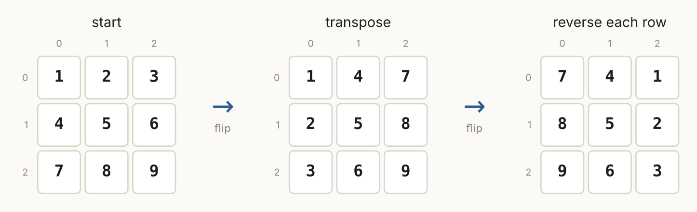

# Review Sheet · 04 Matrix

One page. `grid[r][c]`, row first. Most grid problems are O(m · n): one visit per cell.

## The ideas

| Lesson | Idea | Trigger | Core move | Problems |
|---|---|---|---|---|
| 4.1 | Grid basics | any 2D grid | bounds check before reading a neighbor | 867, 1572 |
| 4.2 | Sets per group | no repeats in each row / column / box | box = `(r // 3) * 3 + c // 3` | 36 |
| 4.3 | Flips and walls | rotate; spiral order | transpose + reverse rows; four walls with re-checks | 48, 54, 59 |
| 4.4 | Record, then write | in-place change that depends on the original | flags in row 0 / col 0; states 2 and 3 | 73, 289 |



## Skeletons

```python
for dr, dc in [(-1, 0), (1, 0), (0, -1), (0, 1)]:
    nr, nc = r + dr, c + dc
    if 0 <= nr < rows and 0 <= nc < cols:
        ...
```

```python
# rotate clockwise in place
for r in range(n):
    for c in range(r + 1, n):
        m[r][c], m[c][r] = m[c][r], m[r][c]
for row in m:
    row.reverse()
```

## Traps

- `[[0] * cols] * rows` shares one row. Use a comprehension.
- Negative indexes read the last row silently. Bounds check first.
- In-place transpose: only swap `c > r`.
- Spiral: re-check `top <= bottom` and `left <= right`. Test one row and one column. (Bug Hunt 4.09)
- Set Matrix Zeroes: never zero during the scan. In the O(1) version, zero row 0 / column 0 last.

## Interleave check

1. "Mirror each row of an image." → ?
2. "Longest substring with no repeats." → ? *(Section 03)*
3. "Rotate a 1D list right by k in place." → ? *(Section 01)*
4. "Count live neighbors of every cell." → ?

<details><summary>Answers</summary>4.3 reverse each row · 3.2 longest-valid window · 1.3 three reversals · 4.1 eight directions + bounds check</details>
